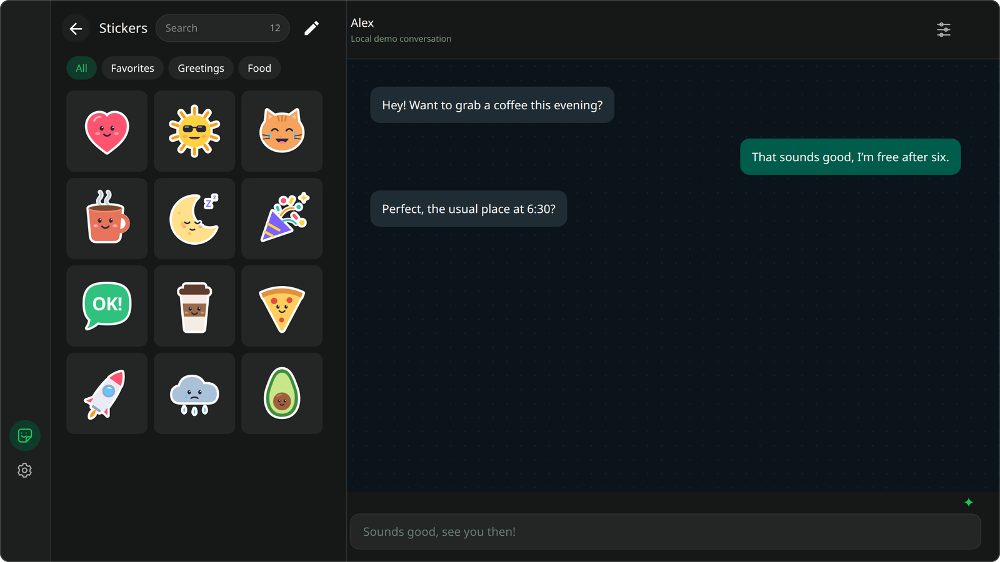
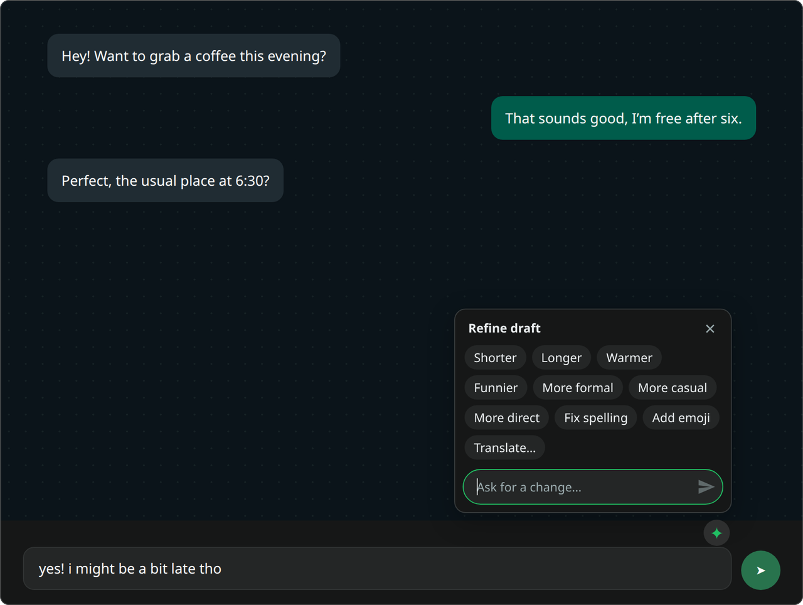
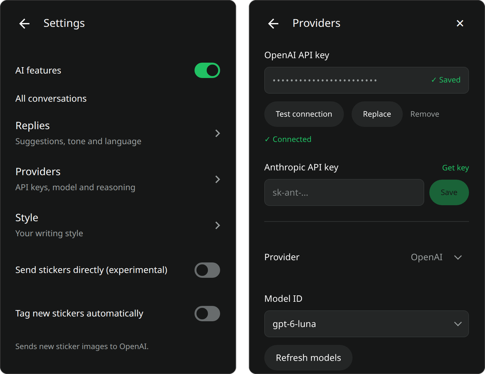

<p align="center">
  
</p>

<h1 align="center">WhatsApp Companion</h1>

<p align="center">
  An unofficial Linux desktop app for WhatsApp Web, with a searchable sticker library and optional AI help with your replies.
</p>

<p align="center">
  <a href="https://github.com/StantonMatt/whatsapp-companion/releases/latest"></a>
</p>



<p align="center"><sub>Shown with the app's built-in demo page and sample data.</sub></p>

## Features

- **Sticker library.** Stickers you come across in WhatsApp are saved to a library on your computer. Search them by your own words, sort them into groups and send one with a click. AI can fill in the search words for you.
- **Reply suggestions.** A suggested reply appears in grey in the message box. Press <kbd>Tab</kbd> to use it; nothing is sent until you send it.
- **Refine and translate.** Click **✦** to make a draft shorter, warmer or more formal, fix its spelling, translate it, or ask for your own change.
- **Your style.** Optionally learn how you write, overall or per chat, so suggestions sound like you.
- **Per-chat settings.** Give any chat its own reply and style settings.
- **Tray.** Closing the window keeps WhatsApp connected in the tray, and the app can start at login.

AI features are optional and off until you turn them on. Everything else works without them.

<p align="center">
  
</p>

## Install

For Linux on x86_64 (tested on Kubuntu).

1. Install the library AppImages need. Kubuntu and Ubuntu 24.04 or newer don't include it:

   ```bash
   sudo apt install libfuse2t64
   ```
2. Download `WhatsApp.Companion-0.3.1.AppImage` from the [latest release](https://github.com/StantonMatt/whatsapp-companion/releases/latest).
3. Move it to a folder you'll keep, make it executable and start it:

   ```bash
   mkdir -p ~/Applications
   mv ~/Downloads/WhatsApp.Companion-0.3.1.AppImage ~/Applications/
   cd ~/Applications
   chmod +x WhatsApp.Companion-0.3.1.AppImage
   ./WhatsApp.Companion-0.3.1.AppImage
   ```

   Or, in Dolphin, right-click the file, choose **Properties → Permissions**, tick **Is executable**, and double-click it.
4. On your phone, open WhatsApp's **Linked devices** and scan the QR code shown in the app.

## First steps

- **Sticker library** and **Settings** (the gear) are added to WhatsApp's left bar.
- Open WhatsApp's sticker picker and let it load; the stickers it shows are added to the library.
- Closing the window leaves the app running in the tray. Use **Quit** in the tray menu to exit. The app starts at login, hidden in the tray; turn that off in the tray menu.

### Turn on AI (optional)

You need your own API key from OpenAI or Anthropic. Your provider bills you for what you use.

1. Open **Settings** and turn on **AI features**.
2. Open **Providers**, paste your key and click **Save**. **Get key** opens the provider's key page.
3. Open **Replies** and turn on **Share recent conversation context** and **Inline suggestions**.

<p align="center">
  
</p>

Your key is encrypted by your system keyring (KWallet or Secret Service). The [user guide](docs/user-guide.md) covers every feature and setting.

## Privacy and limits

- **On your computer.** Settings, the sticker library and learned writing habits are kept in `~/.config/WhatsApp Companion/`. Companion doesn't store your conversation text. Its files aren't encrypted by the app, so use disk encryption if that matters to you.
- **Sent to your AI provider, only when AI is on.** With context sharing on, up to 30 recent messages loaded in the open chat, the sender names shown in group chats, your draft, and attachment types and file names, never the files themselves. AI sticker tagging sends the sticker image. Your provider's retention policy applies. [Full details](docs/data-and-privacy.md#what-your-ai-provider-receives).
- **Unofficial.** Not made by or affiliated with WhatsApp or Meta. WhatsApp updates can break it, and WhatsApp may restrict unofficial clients. The experimental direct sticker sending, off by default, carries some account risk.
- **Linux only for now.** Windows and macOS builds are configured but not validated.
- **Unsigned, no automatic updates.** To update, download the new AppImage from [Releases](https://github.com/StantonMatt/whatsapp-companion/releases) and use it instead of the old one.

If the app says it could not start, your files are kept; see [Recovery](docs/data-and-privacy.md#recovery).

## Build from source

Requires Node.js 22.12+ and npm.

```bash
git clone https://github.com/StantonMatt/whatsapp-companion.git
cd whatsapp-companion
npm ci
npm run dev     # build and open the app
npm run demo    # local demo page; no WhatsApp or provider calls
```

## Documentation

- [User guide](docs/user-guide.md): install, every feature and setting, tray and startup
- [Data and privacy](docs/data-and-privacy.md): what is stored and sent, diagnostics, recovery
- [Development](docs/development.md): running from source, tests, packaging, releases, feature status
- [Implementation notes](docs/implementation.md), [product brief](docs/product-brief.md) and [CI operation](docs/ci.md)

## License

MIT © 2026 Matthew Stanton. See [LICENSE](LICENSE).
